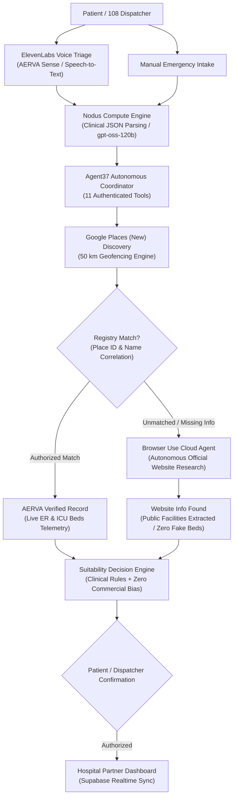

# AERVA — Autonomous Emergency Routing & Verification Architecture

<div align="center">


[](https://aerva-0cvq.onrender.com)
[](https://nextjs.org/)
[](https://flutter.dev)
[](https://supabase.com/)
[](https://docs.browser-use.com/)
[](https://www.agent37.com)
[](https://nodus-compute.ai)
[](https://elevenlabs.io)
[-brightgreen?style=for-the-badge)](tests/)

**Don't just find the nearest hospital. Find the right one.**  
AERVA interconnects patients, 108 dispatchers, and hospitals through real-time authorized bed telemetry, autonomous web research verification, multi-agent AI orchestration, and low-latency voice triage.

[🌐 Live Web Application](https://aerva-0cvq.onrender.com) • [🔑 Unified Sign-In Portal](https://aerva-0cvq.onrender.com/login) • [🏥 Hospital Partner Desk](https://aerva-0cvq.onrender.com/partner) • [🚨 108 Dispatcher Relay](https://aerva-0cvq.onrender.com/reach/relay) • [🧠 AI Evidence Console](https://aerva-0cvq.onrender.com/evidence) • [📱 Download Android APK](https://aerva-0cvq.onrender.com/AERVA_Patient_App.apk)

</div>

---

## 📑 Table of Contents
1. [The Crisis: Why Nearest Hospital Fails](#-the-crisis-why-nearest-hospital-fails)
2. [Multi-Agent System Architecture](#-multi-agent-system-architecture)
3. [Browser Use Cloud Integration](#-browser-use-cloud-integration)
4. [Critical Clinical Safety Rules](#-critical-clinical-safety-rules)
5. [50 km Geofencing & Location Engine](#-50-km-geofencing--location-engine)
6. [Mobile Application (Flutter APK)](#-mobile-application-flutter-apk)
7. [Portals & Unified Access](#-portals--unified-access)
8. [Supabase Setup (1-Click SQL Script)](#-supabase-setup-1-click-sql-script)
9. [Render Deployment Guide](#-render-deployment-guide)
10. [Automated Test Suite (25 / 25 Passing)](#-automated-test-suite-25--25-passing)

---

## 🚨 The Crisis: Why Nearest Hospital Fails

In trauma, stroke, and acute cardiac arrest, **time is tissue**. In India and globally:
* Over **30% of emergency ambulance diversions** occur because the destination facility lacked open resuscitation beds, an on-duty interventional cardiologist, or functional cath labs.
* Patients who navigate solely via generic map pins frequently arrive at clinics that lack emergency receiving authorization or active intensive care capacity.
* **AERVA solves this** by continuously querying live hospital resource telemetry, validating public facility information using autonomous browser agents, and routing patients only to verified facilities with confirmed bed availability.

---

## 🧠 Multi-Agent System Architecture



### Multi-Agent Components:
1. **Nodus Compute (`/api/v1/ai/interpret`)**:
   - High-throughput inference (`https://inference.nodus-compute.ai/v1`) using `nodus/gpt-oss-120b`.
   - Extracts structured clinical parameters: triage acuity, required medical specialties, breathing difficulty, and patient count.
   - Non-diagnostic triage assistance with zero hallucination.

2. **Agent37 Emergency Coordinator (`/api/v1/agent/coordinate`)**:
   - Executes authenticated multi-step tools across the emergency lifecycle:
     - `search_nearby_hospitals`
     - `get_verified_hospital_record`
     - `get_hospital_resources`
     - `filter_hospitals_by_requirements`
     - `prepare_emergency_request`
     - `get_emergency_request_status`
   - Preserves patient safety gates before case dispatch.

3. **Browser Use Cloud (`/api/hospitals/:id/research`)**:
   - Autonomous web researcher targeting official hospital websites.
   - Extracts publicly listed facilities (Emergency Dept, ICU, Oxygen Support, Ambulance).
   - Guarantees strict provenance labelling (`WEBSITE_INFORMATION_FOUND`).

4. **ElevenLabs Voice Suite (`/api/v1/voice/transcribe` & `/api/v1/voice/speak`)**:
   - Real-time speech-to-text with bilingual Hindi/English recognition.
   - Audible readback for bystander stabilization.

---

## 🌐 Browser Use Cloud Integration

When Google Places or OSM discovers a facility whose clinical profile is incomplete in the authorized registry, AERVA initiates a bounded **Browser Use Cloud** research task:

### Workflow:
1. **Discovery**: Google Places identifies candidate hospitals within the 50 km geofence.
2. **Correlation**: Backend attempts Place ID and exact normalized name matching against authorized records.
3. **Research Trigger (`POST /api/hospitals/:id/research`)**: If critical intelligence is absent, backend submits a bounded research task targeting the hospital's verified domain.
4. **Autonomous Agent Execution**: Browser Use Cloud launches a headless Chromium agent that inspects hospital departments, facilities, contact points, and emergency infrastructure.
5. **Deduplication & SSRF Protection**: In-flight tasks are deduplicated via LRU caching (`task-dedup`). Targets with internal IPs, localhost, or RFC1918 schemes are rejected.
6. **Provenance Storage (`hospital_website_research` table)**: Extracted public data is stored in isolation from approved clinical telemetry.

---

## ⚖️ Critical Clinical Safety Rules

AERVA enforces non-negotiable medical data integrity rules:

| Rule | Enforcement |
| :--- | :--- |
| **Zero Bed Fabrication** | Unverified hospitals or web listings **never** report mock beds. `resources: null` is strictly returned. |
| **Website Listed != Available** | Finding an ICU listed on a hospital website does **not** mean ICU beds are open. Live beds remain `null`. |
| **Zero Commercial Bias** | Commercial weight is strictly **`0`**. Hospital sponsored status cannot influence routing decisions. |
| **Distinct Provenance Statuses** | `AERVA Verified`, `Website Information Found`, `Unverified`, and `Stale/Unknown`. |
| **Freshness Expiration** | Verified telemetry older than 2 hours is classified as `unknown_or_stale` and hides live bed counts. |

---

## 📍 50 km Geofencing & Location Engine

* **Haversine Distance**: Both Web API (`/api/hospitals/nearby`) and Mobile App calculate great-circle distances:
  $$\text{dist} = 2 R \arcsin\left(\sqrt{\sin^2\left(\frac{\Delta\phi}{2}\right) + \cos\phi_1\cos\phi_2\sin^2\left(\frac{\Delta\lambda}{2}\right)}\right)$$
* **Worldwide Adaptability**: Seamlessly switches between live GPS geofencing (Guwahati, Kolkata, Delhi-NCR, Mumbai, Bengaluru, or international coordinates).
* **Guwahati Regional Healthcare Hub**:
  * **GMCH (Gauhati Medical College & Hospital)**: `aerva_verified`, 16 ER beds, 6 ICU beds.
  * **Satribari Christian Hospital**: `aerva_verified`, 8 ER beds, 4 ICU beds.
  * **Apollo Excelcare Hospital**: `aerva_verified`, 12 ER beds, 5 ICU beds.
  * **MMC Hospital & Marwari Hospitals**: `unverified` (discovered via OSM/Google, zero mock beds).

---

## 📱 Mobile Application (Flutter APK)

The AERVA mobile application (`nearer_mobile/`) is a native Flutter Android app engineered for high-stress emergency situations:

* **1-Tap Emergency SOS**: Broadcasts GPS coordinates, blood group, allergies, and emergency contact details directly to destination ER desks.
* **Radar GPS Map**: Displays nearby hospitals with color-coded verification badges and real-time travel times.
* **Offline-First Vault**: Caches ABHA health ID, prescriptions, and medical history locally using SQLite and SharedPreferences.
* **Real-time Case Tracking**: Bi-directional Supabase Realtime synchronization shows hospital acceptance, bed reservation, and ambulance dispatch status.

### Direct APK Downloads:
* **Official Release**: [`AERVA_Patient_App.apk`](AERVA_Patient_App.apk) (55.8 MB)
* **Live Web Download**: [https://aerva-0cvq.onrender.com/AERVA_Patient_App.apk](https://aerva-0cvq.onrender.com/AERVA_Patient_App.apk)

---

## 🔑 Portals & Unified Access

Navigate to [`/login`](https://aerva-0cvq.onrender.com/login) to access the unified role portal:

| Role | Route | Purpose | Demo Credentials |
| :--- | :--- | :--- | :--- |
| **Hospital ER Staff** | `/partner/dashboard` | Manage bed telemetry, accept incoming cases, assign doctors | `cmo@apollo.aerva.org` / `aerva@hospital2026` |
| **108 Dispatcher** | `/reach/relay` | Triage rural calls, re-route ambulances, manage diversions | Badge `op_1` / PIN `108-DISPATCH` |
| **Patient Passport** | `/patient` | Access digital medical records, allergy flags, emergency QR | Phone `+91 98765 43210` / PIN `4321` |

---

## 🗄️ Supabase Setup (1-Click SQL Script)

AERVA includes a unified, idempotent SQL script that sets up all 21 tables, views, RLS policies, realtime publications, and verified hospital records.

### Quick Setup:
1. Open your **Supabase Dashboard SQL Editor**:
   ```
   https://supabase.com/dashboard/project/yhrcmowjsuagrhxlchvr/sql/new
   ```
2. Copy the contents of [`supabase/all_in_one_setup.sql`](supabase/all_in_one_setup.sql).
3. Paste into the SQL Editor and click **Run**.
4. All tables, security policies, and seed records will be verified and active.

---

## ⚙️ Environment Variables

Configure these server-side environment variables in `.env.local` or Render:

| Variable | Description |
| :--- | :--- |
| `NEXT_PUBLIC_SUPABASE_URL` | Supabase project URL (`https://yhrcmowjsuagrhxlchvr.supabase.co`) |
| `NEXT_PUBLIC_SUPABASE_ANON_KEY` | Supabase anonymous public key |
| `SUPABASE_SERVICE_ROLE_KEY` | Supabase service role key (backend administrative operations) |
| `BROWSER_USE_API_KEY` | Browser Use Cloud API key for autonomous hospital research |
| `AGENT37_API_KEY` | Agent37 emergency coordination agent API key |
| `AGENT37_INSTANCE_URL` | Agent37 coordination sandbox endpoint |
| `NODUS_API_KEY` | Nodus Compute OpenAI-compatible inference key |
| `ELEVENLABS_API_KEY` | ElevenLabs voice transcription and text-to-speech key |
| `GOOGLE_PLACES_API_KEY` | Google Places API (New) key for hospital discovery |

---

## 🚢 Render Deployment Guide

* **Live Production URL**: [https://aerva-0cvq.onrender.com](https://aerva-0cvq.onrender.com)
* **Unified Role Sign-In**: [https://aerva-0cvq.onrender.com/login](https://aerva-0cvq.onrender.com/login)
* **Health Check & Telemetry**: [https://aerva-0cvq.onrender.com/api/health](https://aerva-0cvq.onrender.com/api/health)

1. **Repository**: Connect GitHub repository `officialjisanhalder-art/near-er` (or `officialjisanhalder-art/AERVA`).
2. **Environment**: Node.js Web Service.
3. **Build Command**:
   ```bash
   npm install && npm run build
   ```
4. **Start Command**:
   ```bash
   npm start
   ```
5. **Health Check Path**: `/api/health` (returns `HTTP 200 OK` with system telemetry).
6. **Add Environment Variables**: Populate the required keys from the table above in Render Environment settings.

---

## 🧪 Automated Test Suite (25 / 25 Passing)

AERVA includes comprehensive automated test suites covering all integrations and clinical safety rules:

```bash
# Run all 25 automated tests
npm run test
```

### Verified Test Breakdown:
* **Phase 10 Integration Tests (`10/10 PASS`)**:
  - `TEST 1`: Nodus Compute JSON parsing & graceful fallback
  - `TEST 2`: ElevenLabs voice transcription & speech-to-text
  - `TEST 3`: Google Places hospital discovery
  - `TEST 4`: Place ID exact correlation with authorized registry
  - `TEST 5`: Unverified hospital zero-fabrication guard
  - `TEST 6`: Real-time ICU capacity impact on match scoring
  - `TEST 7`: Agent37 autonomous tool execution (11 authenticated tools)
  - `TEST 8`: Authorized emergency request submission
  - `TEST 9`: Hospital dashboard real-time acknowledgement
  - `TEST 10`: Outage resilience & manual hospital fallback
* **Hospital Discovery Tests (`7/7 PASS`)**:
  - Place ID verification & provenance isolation
  - Telemetry freshness thresholds (2h expiration)
  - Dynamic capacity update reflections
* **Browser Use Cloud Tests (`8/8 PASS`)**:
  - Unverified Google hospital isolation
  - Website-sourced provenance tagging
  - Listed ICU != Available ICU beds clinical safety check
  - Stale research classification (25h vs 2h)
  - SSRF protection & failure resilience
  - Zero credential leakage verification
  - Task deduplication & cache reuse
  - Non-destructive regression verification

---

<div align="center">
  <b>Built for Hackathon Evaluation • AERVA Emergency Health Architecture</b>
</div>
