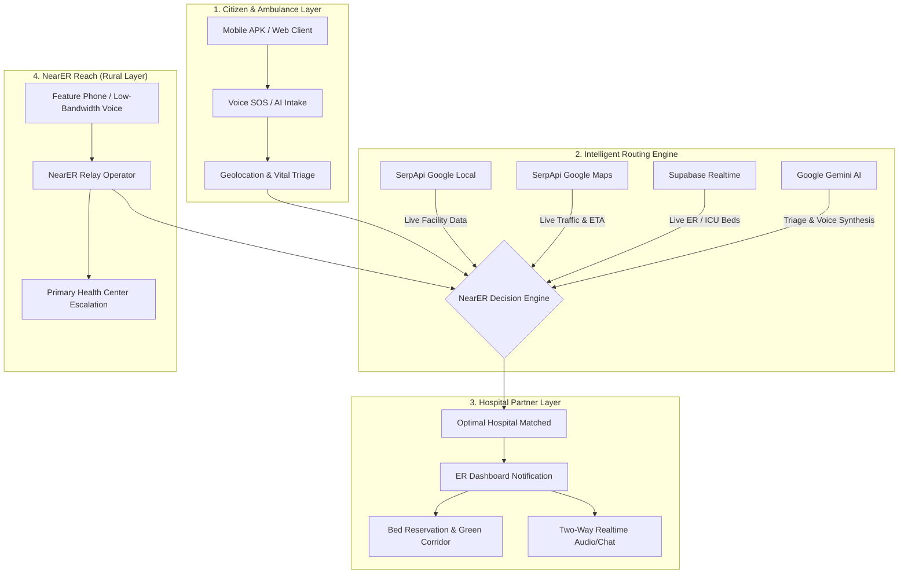

# NearER — Intelligent Emergency Response & Hospital Routing Ecosystem

<div align="center">


[](https://nearer-app.vercel.app)
[](https://nextjs.org/)
[](https://serpapi.com/)
[](https://supabase.com/)
[](https://ai.google.dev/)
[](https://www.typescriptlang.org/)

**Every second counts. NearER eliminates emergency room guesswork by interconnecting patients, live hospital capacity, real-time Google traffic, and rural voice relays into a single unified emergency response network.**

[Explore Live Web App](https://nearer-app.vercel.app) • [Hospital Partner Portal](https://nearer-app.vercel.app/partner) • [NearER Reach (Rural SOS)](https://nearer-app.vercel.app/reach) • [Nearby Emergency Locator](https://nearer-app.vercel.app/nearby)

</div>

---

## 📌 Table of Contents
1. [The Crisis: Why NearER Exists](#-the-crisis-why-nearer-exists)
2. [Ecosystem Architecture](#-ecosystem-architecture)
3. [SerpApi Hackathon Integrations](#-serpapi-hackathon-integrations)
4. [Core Features & Modules](#-core-features--modules)
5. [Tech Stack](#-tech-stack)
6. [Database & Realtime Sync](#-database--realtime-sync)
7. [Screenshots & Visuals](#-screenshots--visuals)
8. [Getting Started & Local Development](#-getting-started--local-development)
9. [Environment Variables](#-environment-variables)
10. [Submission & Team Credits](#-submission--team-credits)

---

## 🚨 The Crisis: Why NearER Exists

In medical emergencies, the nearest hospital is not always the best hospital. Critical minutes are lost when patients or ambulances arrive at facilities that:
- Have **zero available ER or ICU beds**
- Lack specialized departments (e.g., active Cath Lab for cardiac arrest, Burn Units, or CT/MRI for stroke triage)
- Are separated by **unforeseen traffic congestion** or road blocks
- Lack pre-arrival triage data, leaving doctors unprepared until the patient reaches the doors

**NearER solves this end-to-end** by matching patients to facilities based on real-time availability, live traffic conditions, and AI triage, while extending emergency coverage to rural communities through voice relay bridges.

---

## 🏗 Ecosystem Architecture

NearER connects four synchronized stakeholders in real time:



---

## ⚡ SerpApi Hackathon Integrations

NearER leverages **SerpApi** as a mission-critical data backbone across three distinct Google engines:

### 1. 🏥 Real-Time Hospital Discovery (`Google Local API`)
- **Route:** `/api/serp/nearby` & `/nearby`
- Fetches verified medical centers, trauma hospitals, and specialized clinics with live ratings, verified addresses, and operational status.
- Dynamically correlates public Google Local profiles with NearER's real-time bed capacity database.

### 2. 🚦 Live Emergency Route & Congestion Optimization (`Google Maps Directions API`)
- **Route:** `/api/serp/traffic` & `/traffic`
- Computes exact driving distances and live transit durations accounting for current traffic conditions.
- Powers the **Green Corridor Alert System**, helping ambulance drivers choose the fastest feasible transit path rather than just geographic proximity.

### 3. 🩺 AI-Powered First-Aid & Medical Knowledge Card (`Google Search Knowledge Graph`)
- **Route:** `/api/serp/emergency` & `/emergency/analyzing`
- As the AI models analyze incoming voice intake and patient vitals, SerpApi queries the verified Google Knowledge Graph for verified first-aid guidance (e.g., CPR rhythm steps, stroke FAST protocol, severe bleeding pressure tactics).
- Instantly displays clinical advisories to the caller while dispatch and matching happen in the background.

---

## 🎯 Core Features & Modules

### 🚑 1. Patient & Citizen Emergency Experience (`/emergency`)
- **One-Tap Emergency Trigger:** Cardiac, Trauma, Pediatric, Respiratory, Burn, and Stroke profiles.
- **Voice SOS Briefing:** High-clarity audio recording synthesized via Google Gemini for hands-free intake in panic situations.
- **Digital Emergency Pass (`/pass/[caseId]`):** Real-time QR code pass showing ambulance coordinates, vital summary, assigned trauma ward, and attending physician.

### 🏥 2. Hospital Partner Command Center (`/partner`)
- **Real-Time Capacity Tracker:** Live telemetry for ER beds, ICU beds, ventilators, and surgical suites.
- **Incoming Case Queue:** Instant notification stream when high-acuity cases are routed to the facility.
- **Green Corridor Coordinator:** One-click traffic escalation beacon notifying traffic police and dispatch routes.
- **Blood Bank & Capabilities Matrix:** Real-time unit availability (O-, A+, B+, etc.) and specialty flags (Cath Lab 24x7, Trauma Level 1).

### 🌾 3. NearER Reach — Rural Voice Relay (`/reach`)
- Designed for communities with feature phones or intermittent 2G connectivity.
- Translates recorded vernacular voice distress calls into structured medical briefs.
- Enables human relay operators to hand off patients from rural Primary Health Centers (PHCs) to tertiary urban hospitals with full audit logging.

### 🗺️ 4. Turn-by-Turn Transit Navigation (`/navigation/[id]`)
- Emergency driver navigation interface with dynamic ETA updates, reroute triggers, and direct hospital triage line integration.

---

## 🛠 Tech Stack

| Layer | Technologies |
| :--- | :--- |
| **Frontend** | [Next.js 16](https://nextjs.org/) (App Router, Turbopack), [React 19](https://react.dev/), [Tailwind CSS](https://tailwindcss.com/), Lucide Icons |
| **3D & Visuals** | [Three.js](https://threejs.org/), [@react-three/fiber](https://docs.pmnd.rs/react-three-fiber), [@react-three/drei](https://github.com/pmndrs/drei), Canvas 3D |
| **APIs & Live Data** | [SerpApi](https://serpapi.com/) (Google Local, Google Maps, Google Search), [Google Gemini AI](https://ai.google.dev/) |
| **Backend & Realtime** | [Supabase](https://supabase.com/) (PostgreSQL 15, Realtime Broadcast Channels, Row Level Security) |
| **Hosting & Edge** | [Vercel](https://vercel.com/) (Edge Network, Serverless Lambdas) |
| **Mobile** | Standalone Flutter / Android Client APK (`NearER_Patient_App.apk`) |

---

## 🗄 Database & Realtime Sync

The platform uses a relational PostgreSQL schema deployed on Supabase with WebSocket subscriptions:

- `emergency_requests`: Active emergency tickets, voice recordings, vitals, matched hospital ID, status machine.
- `hospitals`: Directory of regional healthcare institutions, geospatial coordinates, verification badges.
- `hospital_capacity`: Real-time operational availability (ER beds, ICU beds, ventilators, OT rooms).
- `blood_inventory`: Stock levels across all blood groups per partner institution.
- `hospital_capabilities`: Verified clinical specialties (Cardiology, Trauma, Neuro, Pediatrics).
- `rural_sos_cases`: NearER Reach feature-phone distress queues and operator assignments.

---

## 🚀 Getting Started & Local Development

### Prerequisites
- Node.js `20.x` or higher
- npm, pnpm, or yarn
- Supabase project credentials
- SerpApi API key
- Google Gemini API key

### 1. Clone the repository
```bash
git clone https://github.com/officialjisanhalder-art/near-er.git
cd near-er
```

### 2. Install dependencies
> **Note:** Use `--legacy-peer-deps` to resolve `@react-three/fiber` peer requirements:
```bash
npm install --legacy-peer-deps
```

### 3. Configure environment variables
Create a `.env.local` file in the root directory:
```env
NEXT_PUBLIC_SUPABASE_URL=https://your-project.supabase.co
NEXT_PUBLIC_SUPABASE_ANON_KEY=your-supabase-anon-key
SUPABASE_SERVICE_ROLE_KEY=your-supabase-service-role-key
GEMINI_API_KEY=your-gemini-api-key
SERPAPI_API_KEY=your-serpapi-key
```

### 4. Setup the database
1. Log into your [Supabase Dashboard](https://supabase.com/dashboard).
2. Open the **SQL Editor**.
3. Run the complete migration script provided at [`supabase/full_schema_and_seed.sql`](supabase/full_schema_and_seed.sql).

### 5. Launch the local development server
```bash
npm run dev
```
Open [http://localhost:3000](http://localhost:3000) in your browser.

---

## 🌐 Live Deployments

- **Production URL:** [https://nearer-app.vercel.app](https://nearer-app.vercel.app)
- **Emergency Gateway:** [https://nearer-emergency.vercel.app](https://nearer-emergency.vercel.app)
- **Status:** 🟢 Live & Operational

---

## 📄 License & Hackathon Submission

Built for the **SerpApi Hackathon 2026** with passion for public health infrastructure, emergency logistics, and civic innovation.

Developed by **Jisan Halder** ([@officialjisanhalder-art](https://github.com/officialjisanhalder-art))
